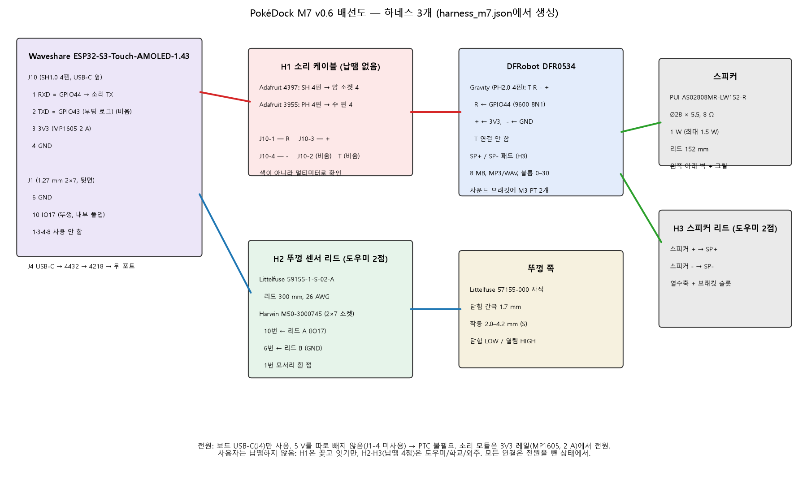

# 04. 전자 (v0.6) — 소리 모듈, 뚜껑 센서, 전원, 핀맵, 하네스

새 PCB는 만들지 않습니다. 보드 사실은 공식 Waveshare 회로도 텍스트층과 대조했습니다(`tests/m7_electrical_check.py`, 32/32 PASS).

- **HOST PASS**: 컴퓨터 안의 검사(회로도 대조, 계산, 펌웨어 시험, 빌드)
- **HARDWARE UNVERIFIED**: 실제 부품을 연결해야 확인되는 항목

v0.5(부저 + MOSFET + 만능기판 모듈)는 `electronics/archive_v0.5/`에 보관했습니다.

## 1. 구성 (한눈에)

| 블록 | 부품 | 연결 | 납땜 |
|---|---|---|---|
| 보드 | Waveshare ESP32-S3-Touch-AMOLED-1.43 (SKU 30106) | — | — |
| 전원·업데이트 | 보드 USB-C(J4) → Adafruit 4432 ㄱ자 → 4218 패널 연장 → 뒤 포트 | 꽂기 | 0 |
| 소리 | DFRobot **DFR0534** + PUI **AS02808MR-LW152-R** 스피커 | J10 ↔ 모듈: H1 (상용 케이블 2개를 꽂아 이음) | H1 0점, H3 2점(도우미) |
| 뚜껑 센서 | Littelfuse **59155-1-S-02-A** + **57155-000** | J1-10 / J1-6: H2 (소켓) | H2 2점(도우미) |

**사용자는 납땜하지 않습니다.**
- 납땜은 도우미·학교·외주가 **4점**만 합니다: H2 2점, H3 2점.
- 사용자는 꽂기, 잇기, 나사 조이기만 합니다.
- **완전 무납땜은 불가능한 이유**:
  - 59155는 납 도금 리드선형만 있고 커넥터 옵션이 없습니다(제조사 데이터시트: 종단 옵션 A = tinned leads만).
  - 작은 스피커도 리드선형입니다. 커넥터가 달린 FIT0502는 공간에 맞지 않아 쓰지 않습니다(§5).

## 2. 회로도 확인 (공식 PDF, HOST PASS)

| 커넥터 | 핀 | 넷 (회로도) | ESP32-S3 | M7 사용 |
|---|---|---|---|---|
| J10 (1.0 mm 4핀, USB-C 옆, 옆으로 꽂음) | 1 | RXD / UART0RXD | 핀 50 = **GPIO44** | 소리 모듈 R (UART1 TX로 씀) |
| | 2 | TXD / UART0TXD | GPIO43 | **비움** (ROM 부팅 로그가 나옴) |
| | 3 | 3V3 | MP1605 벅 출력 | 소리 모듈 + |
| | 4 | GND | | 소리 모듈 − |
| J1 (1.27 mm 2×7 수 헤더, 뒷면) | 6 | GND | | 리드 센서 한쪽 |
| | 10 | IO17 | 핀 23 = **GPIO17** | 리드 센서 다른 쪽 (내부 풀업) |
| | 4 | USB_5V | | **사용 안 함** (v0.5 부저 5 V) |
| | 1, 3 | U_P / U_N | | 사용 안 함 |
| | 8 | IO16 | | 사용 안 함 (v0.5 부저) |

- 3V3 레일은 U3 **MP1605**입니다. 제조사 MPS 기준 출력 2 A, 입력 2.3–5.5 V입니다.
- GPIO44와 GPIO17은 다음 핀과 겹치지 않습니다: 디스플레이(9–14, 21), I2C(47/48), SD(38–41), ADC(4), RTC 인터럽트(15), USB(19/20), 스트래핑(0/3/45/46).
- **J1이 보드 어느 쪽 헤더인지**는 STEP 모델에 표기가 없습니다. 보드 실크(J1 글자)를 보고 정합니다.
  - CAD는 두 위치 모두에서 소켓이 크래들과 간섭하지 않음을 확인했습니다.
  - 덱 배선 구멍도 양쪽에 있습니다.

## 3. UART: GPIO43/44와 다운로드·로그 충돌 검토

| 질문 | 결론 |
|---|---|
| 펌웨어 로그 | `sdkconfig.defaults`: `CONFIG_ESP_CONSOLE_USB_SERIAL_JTAG=y` → 로그와 부트로더 출력은 USB로만 나감. 앱에서 UART0은 비어 있음 |
| 펌웨어 다운로드 | 보드 자체 USB(내장 USB-Serial-JTAG, GPIO19/20)로 함 → J10과 무관 |
| ROM 부팅 로그 | 전원을 넣을 때 칩 ROM이 **GPIO43(J10-2)**으로 115200 baud 텍스트를 보냄. 끄려면 되돌릴 수 없는 eFuse를 바꿔야 함 → **GPIO43은 쓰지 않음** |
| 그래서 | 소리 명령은 **GPIO44(J10-1)**에서 UART1 TX(GPIO 매트릭스)로 보냄. ROM은 일반 부팅 때 GPIO44를 출력으로 쓰지 않음. 스트래핑 핀도 아님 |
| 모듈 응답(T) | 연결하지 않음. 송신 전용이라 모듈이 없거나 고장 나도 펌웨어가 기다리지 않음. 출력끼리 부딪힐 일도 없음 |
| 대안 GPIO16/18 | J1에는 GPIO16이 있지만, 쓰려면 H1도 1.27 mm 소켓이 돼서 납땜이 늘어남. J10만으로 해결되므로 쓰지 않음 |

## 4. 전원과 신호 레벨

| 항목 | 3.3 V (J10-3, **선정**) | 5 V (J1-4 USB_5V) |
|---|---|---|
| 신호 레벨 | 모듈과 ESP32가 같은 3V3 → GPIO44의 High(3.3 V)가 모듈 전원과 같음. 모듈 출력은 연결 안 함 | 모듈 입력 판정 기준이 5 V면 3.3 V High가 애매할 수 있음(제조사 미기재) → 위험 |
| 커넥터 | J10 하나로 끝(납땜 0) | J1 소켓 배선 3가닥 추가(납땜 증가) |
| 전류 제한 | MP1605 벅이 제한(2 A) | USB 어댑터까지 직결. v0.5는 이 때문에 PTC가 필요했음 |
| 출력 | 스피커 최대 약 0.68 W(3.3 V 브리지 이론값) | 더 큼(사용 안 함) |

**전류 예산 (HOST 계산):**

| 항목 | 값 |
|---|---|
| 보드 (화면 + BLE, 보수적) | 0.30 A |
| 모듈 대기 | 약 0.03 A |
| 앰프 최대 (3.3 V / 8 Ω) | 0.41 A |
| **3V3 최대 합** | **0.74 A** (MP1605 2 A의 80 % 안) |
| USB 입력 최대 | 약 0.63 A |

- 펌웨어 볼륨 상한 24/30을 적용하면 USB 입력 최대는 약 0.56 A입니다.
- **KC 5 V 1 A 이상(2 A 권장) 어댑터를 씁니다.** PC USB 포트(0.5 A)로는 업데이트만 하고, 큰 소리 재생은 하지 않습니다.
- **리셋 위험**: 스피커 순간 전류로 3V3가 출렁여 ESP32가 리셋될 수 있습니다. 대응은 두 가지입니다.
  - 볼륨 상한(Kconfig `PD_AUDIO_MAX_VOLUME`, 기본 24)
  - 최대 볼륨에서 3V3 측정(G-A3). 측정 전에는 상한을 올리지 않습니다. **HARDWARE UNVERIFIED**
- **보호 부품**:
  - v0.5의 PTC는 USB_5V를 직접 끌어 쓰던 부저 때문에 필요했습니다.
  - v0.6은 5 V를 따로 빼지 않으므로 PTC를 뺐습니다.
  - H1이 단락되면 3V3이 떨어져 리셋됩니다. 벅 컨버터의 전류 제한 동작은 실물로 시험하지 않았습니다.

## 5. 스피커 선정

| 후보 | 크기 | 연결 | 결과 |
|---|---|---|---|
| **PUI AS02808MR-LW152-R** (선정) | Ø28 × 5.5, 8 Ω, 1 W (최대 1.5 W), 95 dB/1 W/10 cm | 리드 152 mm → 모듈 SP+/SP− 패드 (도우미 2점) | 왼쪽 아래 벽 자리 + 그릴에 맞음 (CAD) |
| DFRobot FIT0502 | 70 × 31 × 15, 8 Ω 3 W | PH2.0 플러그, 모듈 SPK 소켓에 직결 가능 | 공간 탐색 결과 무게추 위 깊은 곳에서 아래를 향해야만 들어감. 소리 통로가 나쁨 → **대안으로만 기록** |
| Adafruit 5986 | 70 × 30 × 17 | JST PH | FIT0502와 같은 이유로 제외 |
| SparkFun COM-21311 | Ø28 | JST | 4 Ω → 제외 |
| Waveshare 2030 캐비티 | — | PH1.25 | 커넥터가 맞지 않음 → 제외 |

모듈의 SPK 소켓은 공식 치수도에서 2.0 mm 간격 2핀입니다. 선정한 스피커는 이 소켓을 쓰지 않고 패드에 직접 납땜합니다.

## 6. 하네스 3개 (`electronics/harness_m7.json`, 핀표 `electronics/M7_PINMAP_KO.md`)

### H1 소리 케이블 — 상용 케이블만, 납땜·압착 없음

| J10 (Adafruit 4397 소켓) | 이음 | DFR0534 Gravity (Adafruit 3955 핀) |
|---|---|---|
| 1 GPIO44 | ↔ | R |
| 3 3V3 | ↔ | + |
| 4 GND | ↔ | − |
| 2 GPIO43 | 비움 (테이프) | — |
| — | 비움 (테이프) | T |

- **선 색을 믿지 않습니다.** 4397은 Qwiic 색(검정 GND, 빨강 3V3, 파랑 SDA, 노랑 SCL)인데, Waveshare J10 순서(RXD, TXD, 3V3, GND)와 다릅니다. "비슷한 SH1.0 커넥터라서 직결"은 하지 않습니다.
- **확인 방법**: `docs/07` S7에서 멀티미터로 확인합니다.
  - GND: USB-C 쉘과 도통되는 소켓
  - 3V3: 전원을 넣고 3.25–3.35 V가 나오는 소켓
  - GPIO44: 배선 시험 모드(전원 넣고 10초 안에 화면 길게 누름)에서 0 V로 떨어지는 소켓
  - 모듈 쪽: 3955 각 핀과 모듈의 VCC/GND/RX/TX 표기 패드 사이 도통
- 3쌍의 이음은 3:1 수축튜브 Ø6(또는 절연테이프 2바퀴)으로 감싸고, 케이블 타이 마운트에 묶습니다.
- Gravity와 SH 플러그는 둘 다 방향 키가 있어 거꾸로 꽂히지 않습니다.

### H2 뚜껑 센서 — 도우미 납땜 2점

- 59155 리드 두 가닥을 Harwin M50-3000745 소켓의 **10번(IO17)**과 **6번(GND)** 꼬리에 직접 납땜합니다.
  - 리드에 극성은 없습니다.
  - 리드 300 mm면 충분하고, 중간 이음이 없습니다.
- 1번 모서리에 흰 점을 찍습니다.
- 180° 거꾸로 꽂아도 5번(IO6)·9번(IO3)에 닿을 뿐입니다. 전원 핀은 쓰지 않으므로 손상이 없고, 뚜껑 감지만 안 됩니다.

### H3 스피커 — 도우미 납땜 2점

- 스피커 + → SP+, − → SP−. 수축튜브를 씌우고, 리드는 사운드 브래킷 슬롯으로 정리합니다.

## 7. 뚜껑 열림 센서 (필수, 기존 설계 유지)

| 항목 | 값 |
|---|---|
| 센서 | Littelfuse 59155-1-S-02-A: NO, 12.70 × 9.00 × 3.00 mm, 26 AWG PVC 300 mm, 끝 6.4 mm 납 도금 |
| 액추에이터 | Littelfuse **57155-000** (DigiKey Korea 재고 928, 2026-11-04) → v0.5의 대체 자석 대신 전용품 사용 |
| 동작 거리 (제조사, S 감도 + 57155) | 작동 2.0–4.2 mm, 해제 2.2–4.7 mm |
| CAD 닫힘 간극 | 1.7 mm (2.0 mm 미만이라 항상 작동), 3.9° 열리면 해제 기준을 넘음 |
| 배선 | GPIO17 – 리드 – GND, 내부 풀업(약 73 µA). 닫힘 = LOW, 열림 = HIGH |
| 펌웨어 | `core/lid_sensor.hpp` 그대로: 120 ms 디바운스, 터치 우선, 3회 모순 시 무시, BLE `lid_sensor` 끄기 |
| 단선 시 | HIGH("열림")로 읽혀 화면이 켜져 있습니다. 꺼진 채 고착되지 않습니다. |
| 홀 센서 | 기존 리드로 동작하므로 바꾸지 않습니다. FK4에서 실패할 때만 검토합니다. |

## 8. 실물에서 확인할 것 (HARDWARE UNVERIFIED)

- G-A1: J10 플러그가 보드에 맞는지, J10 1–4번 실제 순서(멀티미터)
- G-A2: 트랙 1–16이 복사 순서대로 재생되는지(`audio_test` 0–8, 파트너 바꾸기)
- G-A3: 최대 볼륨 24에서 3V3 최저 전압과 리셋 여부(오실로스코프 또는 최소값 기능이 있는 멀티미터)
- G-A4: 그릴 너머 소리 크기(1 m에서 알람이 들리는지)
- G-A5: 모듈 장착 구멍 지름(M3 / M2.5)
- G-L1: J1 실크 위치, 리드 센서 닫힘·열림 (FK4 + 실보드)
- G-P1: 4218로 PC에서 COM 포트가 잡히는지
