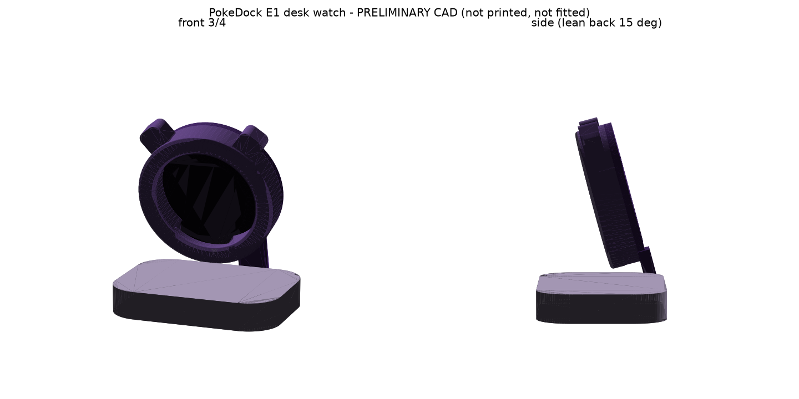

# E1 탁상 워치형 예비안 (2026-11-16) — 예비 CAD, 출력·조립 전

> M7 마스터볼의 외관과 승인 CAD·STL은 **그대로 둡니다**. 이 폴더는 별도의 예비안입니다.
> 실물로 출력하거나 맞춰 본 적이 없으므로 **제작 가능성을 확정하지 않습니다.**

## 구성 (출력 3개)

| # | 부품 | 크기(mm) | 색 | 역할 |
|---|---|---|---|---|
| 1 | 헤드 (`out/e1_head.stl`) | Ø60(귀 포함 63) × 12.8 | 보라 | 베젤 립(유리와 0.6 mm 띄움), 작은 귀 2개, 아래쪽 USB-C·J10 홈 |
| 2 | 뒤판 + 혀 (`out/e1_back.stl`) | Ø60 × 3 + 혀 16 × 12 × 5 | 짙은 보라 | 보드 4개 스탠드오프에 M2, 헤드에 M2 탭핑 3개. 아래 혀가 받침에 꽂힘 |
| 3 | 받침 (`out/e1_base_placeholder.stl`) | 74 × 54 × 12 | 라벤더 | **아직 자리표시용 판**입니다. 혀 홈, USB 플러그·ㄱ자 어댑터 자리, 뒤 케이블 출구는 실물 플러그를 보고 정합니다 |

**철물**: M2×6 접시 4(보드), M2 탭핑 3(뒤판 → 헤드), M3 탭핑 1(혀 → 받침), 고무발 4, ㄱ자 USB-C 어댑터(Adafruit 4432, M7용으로 이미 구매).

**없는 것**: 힌지, 뚜껑, 자석, 리드 센서, 무게추, 벨트, 내부 커버.

## CAD 검사 (`cad/build_watch_e1.py` → `out/watch_e1_report.json`)

| 검사 | 결과 |
|---|---|
| 헤드·뒤판 ↔ 보드(공식 STEP 295개 부품) 간섭 | 0 mm³ |
| USB-C 플러그 몸체(12.4 × 6.5 + 여유) ↔ 헤드·뒤판 | 0 mm³ |
| J10 플러그(소리 모듈 연결 시) ↔ 헤드·뒤판 | 0 mm³ |
| 넘어짐 (대략) | 머리 약 33 g, 받침 약 26 g(채움 45 % 가정). 무게중심이 뒤로 6.7 mm, 받침 반폭 37 mm → 여유 약 30 mm. 케이블이 당기는 힘은 계산하지 않았습니다 |

## M7과 비교

| 항목 | M7 마스터볼 | E1 워치형 |
|---|---|---|
| 출력 판 (X1C CLI 슬라이스) | 시험편 7 + 본 출력 9 = 16판, 약 13시간 56분, 약 432 g | 3판, 약 1시간 20분, 약 48 g (받침은 자리표시 판, 출력 방향 미최적화) |
| 기구 | 힌지·스토퍼·자석 래치·무게추·리드 센서 | 나사 고정만 |
| 조립 난이도 | 높음(SOP S0–S18, 접착·압입) | 낮음(나사 8개) |
| 펌웨어 | m7-0.6.6 그대로 | **그대로** (센서가 없으면 "열림"으로 읽혀 계속 켜져 있음, 설계 동작) |
| 소리 | 하단 쉘 안 DFR0534 + 28 mm 스피커 | 받침을 키워 같은 부품을 넣는 변형(받침 약 80 × 60 × 20)이 가능. 이번 예비 CAD에는 넣지 않음 |
| 책상 면적 | Ø138 볼 | 74 × 54 |
| 선물 인상 | 마스터볼 개폐 연출이 핵심 | 작은 팬텀 시계 |
| 위험 | 시험편 7종 검증 필요 | 받침·케이블 처리 미정. 정면 화면 각도 15°는 실물 확인 필요 |

## 다음에 정할 것 (실물 필요)

- USB-C 케이블과 4432 어댑터를 실제로 꽂았을 때의 높이 → 받침 홈 깊이와 뒤 출구 위치
- 헤드 각도(15°)와 귀 모양: 출력 1회로 보고 정합니다
- 소리를 넣는다면 받침 변형(DFR0534 + 스피커, 앞쪽 그릴)
